# Daily Banner: an animated SVG banner for your GitHub profile README

Daily Banner is a free, open-source **GitHub Action and command-line tool that generates an animated SVG banner for
your GitHub profile README**. It types your headline, a little cat watches, and on special days (Christmas, Halloween,
Pi Day…) the scene changes by itself. No server, no token, no dependency: the Action draws one SVG a day and commits it
to **your own** repository, so your profile never depends on someone else's web service.

[](https://github.com/Florian-85/daily-banner/actions/workflows/tests.yml)
[](https://github.com/Florian-85/daily-banner/releases)
[](LICENSE)

<p align="center">
  
</p>
<p align="center">
  
  
  
  
</p>

> **Status: v0.1.0, first release.** Works end to end, limited on purpose (see [Limits](#limits)). Please report anything that does not work for you in an issue.

## ⚡ Quick setup

You need a GitHub **profile repository** (a public repository named exactly like your username, with a `README.md`).

### 1. Add your settings

Create `daily-banner.json` at the root of that repository:

```json
{
  "name": "Sam Rivera",
  "headline": ["Developer", "Open source fan", "Cat person"],
  "subtitle": "I build things and write about them.",
  "location": "Somewhere · Earth",
  "theme": "dark"
}
```

Only `name` is required. All options: [docs/customization.md](docs/customization.md).

### 2. Add the workflow

Create `.github/workflows/daily-banner.yml` with exactly this (also in [examples/daily-banner-workflow.yml](examples/daily-banner-workflow.yml)):

```yaml
name: Daily Banner

on:
  workflow_dispatch: # lets you run it by hand the first time
  schedule:
    - cron: "5 0 * * *" # then every day at 00:05 UTC

permissions:
  contents: write # the only permission needed: the workflow commits the SVG files

concurrency:
  group: daily-banner
  cancel-in-progress: true

jobs:
  banner:
    runs-on: ubuntu-latest
    timeout-minutes: 5
    steps:
      - uses: actions/checkout@v6
      - uses: Florian-85/daily-banner@v0.1.0
        with:
          config: daily-banner.json
          output-dir: assets
```

### 3. Run it once

On GitHub: **Actions → Daily Banner → Run workflow**. After about a minute the file `assets/daily-banner.svg`
exists in your repository. **The image does not exist before this first run.**

### 4. Add one tag to your README

```html

```

That is all. The workflow now runs every day and commits a new picture only when it changed.

### Light and dark mode (optional)

To show the light banner to readers using GitHub's light theme, and the dark one otherwise:

```html
<picture>
  <source media="(prefers-color-scheme: dark)" srcset="./assets/daily-banner-dark.svg">
  <source media="(prefers-color-scheme: light)" srcset="./assets/daily-banner-light.svg">
  
</picture>
```

## Options (short)

| Option | Default | Example |
|---|---|---|
| `name` | required | `"Sam Rivera"` |
| `headline` | `["Hello, world!"]` | `["Developer", "Writer"]` |
| `subtitle`, `location` | none | `"I build things."`, `"Paris"` |
| `theme` | `"dark"` | `"light"` |
| `lang` | `"en"` | `"fr"` |
| `mascot` | `"cat"` | `"stars"`, `"none"` |
| `font` | `"poppins"` | `"spectral"`, `"nunito"`, `"caveat"`, `"silkscreen"` |
| `textBackend` | `"auto"` | `"embedded"`, `"system"` |
| `timezone` | `"UTC"` | `"Europe/Paris"` |
| `exclude` | `[]` | `["halloween"]` |
| `days` | `[]` | `[{ "date": "04-19", "scene": "birthday" }]` |

Themes, scenes, packs, your own mascot: [docs/customization.md](docs/customization.md).
Action inputs: `config`, `output-dir`, `date`, `commit` (set `"false"` to only generate), `commit-message`.

## Preview on your computer

Requires Node 20 or newer, no install.

```bash
node bin/daily-banner.cjs init                                   # writes daily-banner.json
node bin/daily-banner.cjs generate --out assets --scene noel     # preview any scene
```

The same configuration and date always produce the same bytes.

## Troubleshooting

| Symptom | Cause and fix |
|---|---|
| The image is broken (no picture) | The workflow has not run yet, or `output-dir` differs from the path in your ``. Run it from the Actions tab and check that `assets/daily-banner.svg` exists. |
| The run fails with `Permission to … denied` (403) | Add `permissions: contents: write` to the workflow, and check *Settings → Actions → General → Workflow permissions* does not forbid it. |
| The run fails with `"…" must be one of …`, `Unknown option` or `not valid JSON` | Your `daily-banner.json` has a typo; the message names the field. Check commas and quotes. |
| `Configuration file not found` | `config` is relative to the repository root, and `actions/checkout` must run first. |
| The banner does not change from one day to the next | Browsers and GitHub cache images for a while: refresh, or wait. On a forked or inactive repository, GitHub **disables scheduled workflows after 60 days without repository activity**: re-enable it in the Actions tab. Each daily commit counts as activity, but verify this on your own repository. |
| The date is off by one | "Today" is computed in UTC; set `"timezone": "Europe/Paris"` (or yours). |
| The name is refused as too long or too wide | 32 characters at most; wide letters (W, M) use more room. |

## Limits

- Text is drawn from five bundled fonts (Poppins, Spectral, Nunito, Caveat, Silkscreen): Latin letters with accents, Regular weight, no kerning. Other scripts (CJK, emoji, Greek, Cyrillic, Arabic...) are drawn by the viewer's fonts at an estimated width, and right-to-left text is not supported.
- Scenes: Christmas, Halloween, New Year, April Fools, Pi Day, and a birthday scene for your own dates. One cat and a star constellation, plus your own constellation file.
- English and French celebration phrases. No right-to-left layout.
- SMIL animations cannot be paused by "reduce motion" settings. Nothing flashes more than 3 times per second (tested).
- No hosted URL mode: the evaluation concluded **no-go for v0.1** ([docs/web-option-cloudflare.md](docs/web-option-cloudflare.md)).
- Not verified yet on a real public README: the display after a first scheduled run (see [the checklist](docs/publication-checklist.md)). Reports are welcome.

## How it differs from other profile README tools

| | Daily Banner | Tools served from a web address (for example a typing-text or stats image URL) |
|---|---|---|
| Where the picture is made | A GitHub Action, in your repository, once a day | A third-party server, when a reader opens your profile |
| If the service goes down | Nothing changes: the file is already in your repository | The image can break |
| Your data | Stays in your repository | Goes through a hosted URL |
| Setup | A config file and a workflow, run once | One image URL |
| Changes with the day | Yes: special-day scenes and a rotating headline | Not built in |

Daily Banner trades the one-line URL for independence from any server. A hosted option may come later (see
[the study](docs/web-option-cloudflare.md)); today the Action is the recommended way to get a banner that updates by itself, and the command line (see [Preview on your computer](#preview-on-your-computer)) generates the same files locally.

## Frequently asked questions

**How do I add an animated banner to my GitHub profile README?**
Create `daily-banner.json`, add the workflow from the [Quick setup](#-quick-setup), run it once from the Actions tab, then
add one `` tag. The banner updates itself every day.

**Does it work with the dark and light modes of GitHub?**
Yes. The Action writes `daily-banner-dark.svg` and `daily-banner-light.svg`; use the `<picture>` snippet above to show the
right one.

**Do I need a token, a server or an account somewhere?**
No. The workflow uses the built-in `contents: write` permission to commit the picture to your repository. Nothing is
sent anywhere.

**Is the animation shown on GitHub?**
Yes. The banner is an SVG with SMIL animation inside an `` tag, which GitHub displays and animates. It contains no
script and makes no external request.

**Can I change the fonts, the language or the mascot?**
Yes: five bundled fonts (Poppins, Spectral, Nunito, Caveat, Silkscreen), English or French celebration phrases, and a cat,
a star constellation, your own constellation file or no mascot. See [customization](docs/customization.md).

**Can I use it for a company or an organisation profile?**
Yes, for any GitHub profile or repository README. The licence is the GNU AGPL-3.0; the pictures you generate are yours.

**Why does my banner not change from one day to the next?**
Check that the workflow ran (Actions tab) and see the [troubleshooting](#troubleshooting) table: caching, the time zone and
GitHub pausing scheduled workflows after 60 days without activity are the usual causes.

**Is there a web address I can paste instead of installing the Action?**
Not yet. See [the study](docs/web-option-cloudflare.md) and the open issue about it.

## More

- [Customization](docs/customization.md) · [Design: anchors, variants, fonts, assets](docs/design-anchors-variants.md) · [Web option study](docs/web-option-cloudflare.md) · [Publication checklist](docs/publication-checklist.md)
- [Origin of the code](docs/export-from-homelab.md) · [Credits](CREDITS.md)
- Tests: `npm test` (offline, no dependency).
## License

Copyright (C) 2026 Florian BERTHET. [GNU AGPL-3.0](LICENSE): you may use, modify and share the code, and a modified version offered as an online service must publish its source. The cat and every drawing are original work under the same licence. The name and mascot as a brand are covered by [TRADEMARK.md](TRADEMARK.md). Banners you generate are yours.
